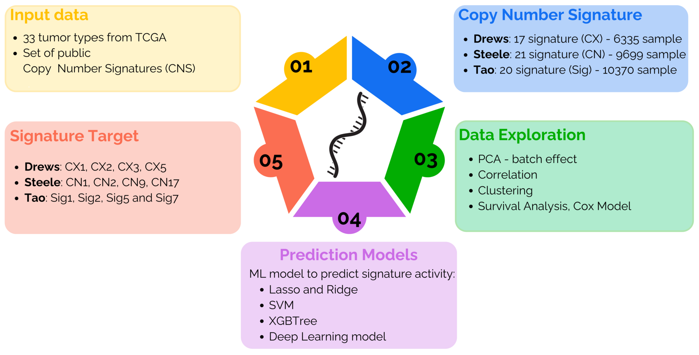

# CNS_ML

Analysis code and processed data for the manuscript **Pan-cancer benchmarking reveals complementary copy
number signatures with distinct multi-omic predictability**.

The repository contains the analysis notebooks, the scripts and functions they
use, processed inputs, and the result tables reported in the paper. Raw TCGA
data and source files from the three copy number signature studies are not
redistributed.



*Overview of the study workflow (Figure 1a of the manuscript).*

## Repository structure

```text
CNS_ML/
├── README.md
├── LICENSE
├── LICENSE-DATA.md
├── environment.yml
├── assets/
│   └── figure1_panel_a.png
├── data/
│   ├── README.md
│   └── processed/
│       ├── *.RData
│       ├── fga_pancanatlas.csv
│       ├── fga_pancanatlas_provenance.txt
│       └── zenodo/
├── code/
│   ├── 00_data_preprocessing.Rmd
│   ├── 01_signature_exploration.Rmd
│   ├── 02_clustering.Rmd
│   ├── 03_survival_analysis.Rmd
│   ├── 04_machine_learning.Rmd
│   ├── 05_methylation_batch_effect.Rmd
│   ├── 06_fraction_genome_altered.Rmd
│   ├── R/          functions used by the notebooks and scripts
│   ├── scripts/    figure scripts and long-running analyses
│   └── tests/      synthetic checks of the classifier workflow
├── results/
│   └── README.md   result tables (figure files are written to results/figures/)
└── Methylation_batch_ correction_result/
```

## Reproducing the analyses

Create the R/Python environment with:

```bash
conda env create -f environment.yml
conda activate cns_ml
```

The notebooks should be run in numerical order. Notebooks `01`, `02`, `03`,
`06`, and the Supplementary Figure 6 section of `05` can be run using the
processed files included in this repository. Notebook `00` documents the
complete, computationally intensive preprocessing workflow and uses external
input paths.

Notebook `04` records the model specifications, hyperparameter grids, and
performance-extraction procedures of the continuous signature models, and
describes the Cluster 1 versus Cluster 2 classifiers. These classifiers are
fitted from the command line, because fitting them takes several hours; their
summary tables are included in `results/cluster_prediction/`. Scripts are run
from the repository root.

## Analysis notebooks and scripts

| Notebook | Manuscript content |
| --- | --- |
| `code/00_data_preprocessing.Rmd` | Multi-omics preprocessing and stratified train/test splitting |
| `code/01_signature_exploration.Rmd` | Signature distributions, PCA, Pearson correlations, Jaccard analyses, composition of binary agreement and threshold sensitivity |
| `code/02_clustering.Rmd` | Patient clustering, cluster composition, overlap of clusters across compendia |
| `code/03_survival_analysis.Rmd` | Kaplan-Meier curves, stratified Cox models, survival tables |
| `code/04_machine_learning.Rmd` | Continuous signature prediction and cluster prediction models |
| `code/05_methylation_batch_effect.Rmd` | Methylation platform harmonization, batch-effect checks, and Supplementary Figure 6 |
| `code/06_fraction_genome_altered.Rmd` | Fraction genome altered in the clustering, survival, and prediction analyses |

| Figure | Code |
| --- | --- |
| Figure 1 | Study design (a) and literature-based mapping of the signatures (b); not generated from data |
| Figure 2 | `code/01_signature_exploration.Rmd` |
| Figure 3 | `code/01_signature_exploration.Rmd` |
| Figure 4 | `code/01_signature_exploration.Rmd` |
| Figure 5 | `code/02_clustering.Rmd`; publication file `code/scripts/figure5.R` |
| Figure 6 | `code/03_survival_analysis.Rmd` |
| Figure 7 | `code/03_survival_analysis.Rmd` |
| Figure 8 | `code/04_machine_learning.Rmd`: classifiers `code/scripts/cluster_prediction.R`, figure `code/scripts/figure8.R` |

The binary agreement of all signature pairs under the four activity thresholds
is in `results/binary_concordance/` (`pair_metrics.csv`, `thresholds.csv`).

### Cluster assignments

The patient clusters used throughout the study are the saved Gaussian
mixture fits `mc_drew_active_4`, `mc_steele_active_4` and `mc_tao_active_4`
in `data/processed/clustering_data.RData` (the same fits are stored in
`surv_data.RData`). Load these objects and match their `classification` to
patients by TCGA barcode rather than refitting the models. Refitting `Mclust`
on the same signature activities can converge to a different partition,
because the hierarchical initialization depends on the row order of the input
and on package defaults that differ between `mclust` versions. All clustering,
survival, prediction, and fraction-genome-altered analyses in this repository
use the saved fits.

### Cluster classifiers

The Cluster 1 versus Cluster 2 classifiers (notebook `04`) need
`final_matrices.RData` from Zenodo in `data/processed/zenodo/`; the variant
with filters refitted on each training set also needs
`exp_meth_post_normalization.RData`. On a workstation:

```bash
THREADS=4 bash code/scripts/run_cluster_prediction.sh
```

On a SLURM cluster, `code/scripts/slurm_submit_cluster_prediction.sh` submits
each inner cross-validation fold as a separate job. One tuning fold takes about
7 to 12 hours with 8 CPUs. Completed folds and splits are checkpointed, and
rerunning resumes. The multi-omic classifiers were fitted with XGBoost 3.2 and
the FGA-only classifiers with XGBoost 1.7.5, both with `tree_method = "hist"`.
Synthetic checks of the workflow are in `code/tests/`.

## Data

Small processed inputs required by the notebooks are stored in
`data/processed/` and described in [`data/README.md`](data/README.md). The
large starting matrices are distributed through the associated
[Zenodo record](https://doi.org/10.5281/zenodo.20617051):

- `final_matrices.RData` contains the final Drews, Steele, and Tao multi-omics
  matrices. These matrices allow users to recreate the train/test partitions
  and retrain any of the models described in `04_machine_learning.Rmd`.
- `exp_meth_post_normalization.RData` contains `ordinata`, the harmonized
  pan-cancer expression and methylation matrix used by the preprocessing
  workflow.
- `cluster_prediction_patient_level.zip` contains the patient-level split
  assignments, test-set predictions, and bootstrap replicates of the cluster
  classifiers, to be extracted into `results/cluster_prediction/`.

Place the downloaded `.RData` files in `data/processed/zenodo/`. File contents
and dimensions are listed in
[`data/processed/zenodo/README.md`](data/processed/zenodo/README.md).

The folder `Methylation_batch_ correction_result/` contains the per-tumor
diagnostic plots used to identify the Infinium I/II probe-design bias and
assess BMIQ normalization.

## Outputs

The result tables are in `results/` and described in
[`results/README.md`](results/README.md). The figures can be generated by
running the corresponding notebooks and scripts; figure files are written to
`results/figures/`. The final publication-quality figure files are provided
with the manuscript rather than duplicated in this repository.

## Citation

The processed datasets are available from Zenodo:
https://doi.org/10.5281/zenodo.20617051.

## License

Code and analysis notebooks are licensed under the
[MIT License](LICENSE). Original documentation, figures, and processed data
produced for this project are licensed under
[CC BY 4.0](LICENSE-DATA.md).

Source data and third-party materials, including material derived from TCGA,
the NCI Genomic Data Commons, cBioPortal, and the cited signature studies,
remain subject to their original access conditions, licenses, and citation
requirements.
